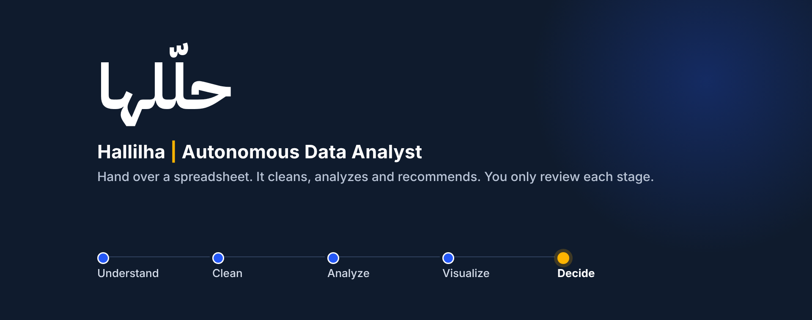

<p align="center"></p>

# حلّلها | Hallilha: an autonomous data analyst

A personal project by **Zyad Hefni**.


**The process automated:** the recurring analysis of a business table (sales, HR, support). Understanding the file, cleaning it,
analyzing it, charting it and recommending an action is hours of analyst work every time. Hallilha does all of it. A person only
*reviews*: after each of five stages the agent shows what it did and what changed; the person approves, sends it back with a note, or
switches off single cleaning changes. **Autopilot** continues alone while every check passes and stops when something needs a person.

**The idea in one line:** the AI proposes, the code verifies.

## Run
```bash
python3 -m pip install -r requirements.txt        # exact tested versions: requirements-lock.txt
export GEMINI_API_KEY=your_key                    # see .env.example
export GEMINI_MODEL=gemini-3.8-flash
python3 server.py                                 # http://127.0.0.1:8000
# or: docker build -t hallilha . && docker run -p 8000:8000 -e GEMINI_API_KEY=... hallilha
```
Input: any CSV up to 5 MB (upload, or use a built-in sample). No key needed to try the pipeline: `LLM_BACKEND=fake python3 server.py`
(rule-based stand-in, no model). Try `testfile/messy_sales.csv` (answer key: `testfile/answer_key.json`, checker: `testfile/compare.py`).

## How it works
| Stage | The model | Code |
|---|---|---|
| Understand | explains columns, goal, assumptions | computes the column profile (the model sees this, not the whole file) |
| Clean | proposes steps in a closed JSON vocabulary | executes and **verifies each step** (no unexpected row loss, no lost column, untouched columns unchanged); rejects bad steps; every step can be switched off |
| Analyze | writes analysis code | runs it in a sandbox (AST whitelist, restricted builtins, no files or network, resource limits, 40 s timeout); one repair round |
| Visualize | chooses chart type and columns | validates against the table and draws it |
| Decide | writes headline, findings, recommendations | **every number must trace to a computed table** (else rewritten once, then flagged); a volume vs rate split separates real anomalies from order-count noise |

## Results (held-out, reproducible)
Data is **synthetic by design**: `gen_data.py` builds a clean ground-truth table, then plants known problems (duplicates, mixed date
formats, currency text, placeholders, spelling variants, impossible values, x100 typos) and one hidden business change. Development
used seeds 1 and 2. Results below are on held-out seeds 101 and 102 (6 files per row).

| Experiment | Problems fixed | Cells damaged | Hidden change found | In the headline | False alarm |
|---|---|---|---|---|---|
| Base run | 100% | 0% | 100% | 83% | 0% |
| 2.5x noisier data | 100% | 0% | 83% | 67% | 0% |
| Arabic column names | 100% | 0% | 83% | 83% | 0% |
| Only 300 rows | 100% | 0% | 83% | 83% | 0% |
| US dates, Arabic/European numbers | 100% | 0% | 83% | 83% | 0% |
| Every file run 3 times (18 runs) | 100% | 0% | 100% | 78% | 0% |
| No hidden problem (control) | 100% | 0% | n/a | n/a | 17% |

Comparisons:
- **One prompt with the whole CSV** finds the hidden change as often (100%), but counts records correctly 50% of the time (Hallilha 100%) and its computed averages are off by 3.3% (Hallilha 0.0%).
- **Rules only, no model:** fixes 98.6% of problems but finds the hidden change in 33% of files (Hallilha 100%).
- **Ablations:** removing verification or number grounding did not change results on this data. The model did not make those mistakes, so these guards are safety nets we could not measure here.
- **The control found a bug:** with no hidden problem, 75% of runs raised a false alarm. A prompt rule cut it to 17%. It is not zero. `CHANGELOG.md` lists every failure found and what changed.

```bash
./run_experiments.sh                      # every experiment -> results/*.json and results/RESULTS.md
python3 eval.py --split test [--variant base|noisy|arabic|small|locale|null|requery] [--no-verify] [--no-grounding] [--repeat 3]
python3 oneshot_eval.py --split test      # the one-prompt baseline
python3 -m pytest tests                   # regression tests (offline)
```

## Limits (what is not proven)
- Synthetic evaluation data with one kind of insight, and a small held-out set of 6 files. Not tested on real enterprise data yet.
- Output varies between runs: the finding led the headline in 78% of repeated runs.
- Single table per run, CSV input only.
- Hosted model: the Gemini API receives column profiles and computed tables (not the whole file). For sensitive data the model sits behind
  one interface (`generate(system, messages) -> JSON`) and already runs with two backends (Gemini and rules only). A self-hosted model
  is untested and would need the same held-out evaluation.
- Numbers are verified against computed tables, but the *interpretation* of a finding is a model judgement, which is why a person reviews it.

